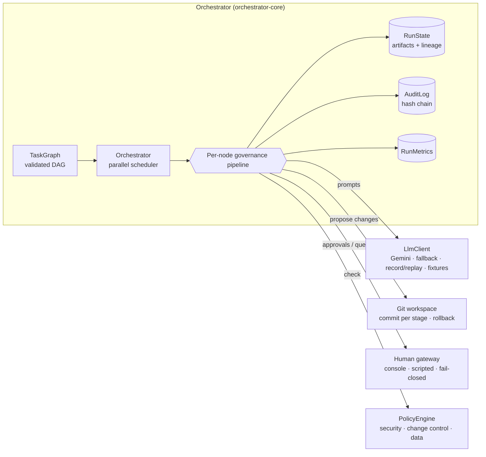
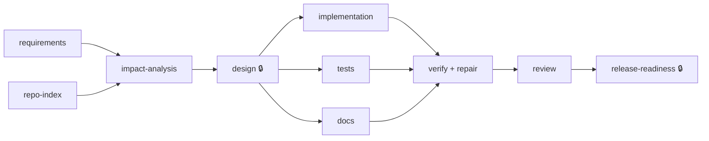

# Agentic SDLC Orchestrator → URL Shortener

A governed, multi-agent orchestration engine that takes a software requirement through the full
SDLC — requirements, codebase analysis, design, implementation, tests, docs, verification, review,
release readiness — and the **URL shortener service** it builds and evolves.

> **Principle:** agents execute inside explicit autonomy boundaries; humans own approvals and final quality.
> Every agent output passes deterministic gates and policy guardrails before it can touch the codebase,
> high-impact actions stop for a human, and everything is recorded in a tamper-evident audit log.

| Part | What it is | Stack |
|---|---|---|
| [`orchestrator-core/`](orchestrator-core) | DAG engine, gates, policies, approvals, retries/fallback/rollback, safe-stop, re-planning, audit, metrics, agents, CLI | Java 21, **zero runtime dependencies** |
| [`url-shortener-service/`](url-shortener-service) | The product: create / redirect / analytics / disable, rate limiting, idempotency | Spring Boot 3.5, PostgreSQL + Flyway |
| [`web/`](web) | Shortener UI + read-only **orchestration console** (DAG, decisions, metrics of recorded runs) | Angular 20 (standalone, signals) |
| [`scenarios/`](scenarios) | Greenfield, brownfield and ambiguous scenario definitions | JSON |
| [`runs/`](runs) | Committed evidence for each scenario: report, decision log, audit chain, diff | Markdown / JSON |
| [`docs/`](docs) | [Architecture](docs/architecture.md), [scenario walkthroughs](docs/scenarios.md) | |

---

## Quick start

**Prerequisites:** JDK 21, `git`, `sh` (Linux/macOS/WSL). Node 22 only for the web UI. Docker optional.

```bash
# 1. Build everything and run all tests (unit, integration, ArchUnit, and the 3 scenarios end-to-end)
./gradlew build

# 2. Run a scenario offline — no API key needed (hand-written fixtures stand in for the model)
./gradlew :orchestrator-core:run --args="run --scenario scenarios/greenfield/scenario.json --llm offline"
./gradlew :orchestrator-core:run --args="run --scenario scenarios/brownfield/scenario.json --llm offline"
./gradlew :orchestrator-core:run --args="run --scenario scenarios/ambiguous/scenario.json --llm offline --replan"

# 3. Run a scenario LIVE against Gemini, recording responses for deterministic replay
export GEMINI_API_KEY=...            # never commit it; see .env.example
./gradlew :orchestrator-core:run --args="run --scenario scenarios/brownfield/scenario.json --llm gemini --record"
./gradlew :orchestrator-core:run --args="run --scenario scenarios/brownfield/scenario.json --llm replay"

# 4. Be the human in the loop (approve / reject / request changes / answer questions at the terminal)
./gradlew :orchestrator-core:run --args="run --scenario scenarios/ambiguous/scenario.json --llm gemini --interactive" --console=plain

# 5. Cross-run reliability metrics, audit verification
./gradlew :orchestrator-core:run --args="metrics"
./gradlew :orchestrator-core:run --args="verify-audit runs/<run-id>/audit.jsonl"

# 6. The service (H2 in memory) + UI
./gradlew :url-shortener-service:bootRun          # http://localhost:8080/swagger-ui.html
cd web && npm install && npm start                # http://localhost:4200 (proxies /api to :8080)

# 7. Production-like: PostgreSQL + single image (UI + API)
docker compose up --build                         # http://localhost:8080
```

Each run writes `runs/<run-id>/`: `report.md` (DAG, stages, metrics, decision log, lineage),
`run.json`, `audit.jsonl` (hash-chained), `changes.patch`, `artifacts/`, and the agent's git
`workspace/` (one commit per stage on branch `agent/<run-id>`).

---

## Architecture at a glance



**The SDLC graph** (two parallel fan-outs with explicit joins; 🔒 = mandatory human sign-off):



**Every node runs through the same governance pipeline:**

```
entry gates ─► attempt loop ─────────────────────────────────────────────────────────────► record lineage
                 │ execute agent (sees previous failure + reviewer feedback)
                 │ blocking questions?  → human clarification → re-plan this stage
                 │ policy guardrails    → BLOCK: reject, agent retries with the violation
                 │ approval needed?     → human: approve / reject / request changes (bounded revisions)
                 │ apply + exit gates   → atomic; failure ⇒ git rollback to checkpoint, retry
                 │ commit
                 └ retries exhausted    → fallback strategy → else FAIL; downstream SKIPPED
safe-stop (kill switch, LLM-call budget, wall-clock budget) is checked between and inside stages
```

Details, state machine, concurrency model, failure matrix and ADRs: **[docs/architecture.md](docs/architecture.md)**.

---

## Assignment requirements → where they live

| Requirement | Implementation |
|---|---|
| Requirement understanding, ambiguity → normalised problem | [`RequirementsAgent`](orchestrator-core/src/main/java/io/github/hemanthvk980/orchestrator/agents/RequirementsAgent.java): HIGH-impact ambiguities become **blocking questions**; others become logged assumptions. Gate `ambiguities-resolved` stops design until resolved |
| Task decomposition with dependencies | [`DesignAgent`](orchestrator-core/src/main/java/io/github/hemanthvk980/orchestrator/agents/DesignAgent.java) emits tasks with `dependsOn`; exit gate validates the plan is a DAG; [`TaskPlan`](orchestrator-core/src/main/java/io/github/hemanthvk980/orchestrator/agents/TaskPlan.java) orders execution |
| Codebase reasoning (brownfield) | Deterministic [`RepoIndexStage`](orchestrator-core/src/main/java/io/github/hemanthvk980/orchestrator/agents/RepoIndexStage.java) (endpoints, entities, migrations, tests) + [`ImpactAnalysisAgent`](orchestrator-core/src/main/java/io/github/hemanthvk980/orchestrator/agents/ImpactAnalysisAgent.java) with a **hallucination gate** (every impacted file must exist) |
| Explicit dependency graph, entry/exit gates | [`TaskGraph`](orchestrator-core/src/main/java/io/github/hemanthvk980/orchestrator/graph/TaskGraph.java) (cycle/unknown-dep validation, layers), [`Gates`](orchestrator-core/src/main/java/io/github/hemanthvk980/orchestrator/gate/Gates.java) |
| Sequential + parallel paths with synchronisation | Virtual-thread scheduler in [`Orchestrator`](orchestrator-core/src/main/java/io/github/hemanthvk980/orchestrator/engine/Orchestrator.java); joins = dependency edges; workspace mutations serialised |
| Cross-stage context, decision lineage | [`RunState`](orchestrator-core/src/main/java/io/github/hemanthvk980/orchestrator/engine/RunState.java): content-hashed artifacts record the input hashes that produced them; [`Decision`](orchestrator-core/src/main/java/io/github/hemanthvk980/orchestrator/engine/Decision.java) log with actor (agent / human / system) |
| Human approval for high-impact actions | Node-level `requiresApproval` (design, release) + policy-triggered approvals (migrations, build files, protected files) + agent-raised reasons (HIGH review findings, repairs touching tests). Unattended runs **fail closed** |
| Bounded retries, fallback, rollback, safe-stop | [`RetryPolicy`](orchestrator-core/src/main/java/io/github/hemanthvk980/orchestrator/graph/RetryPolicy.java) (1–10, exp. backoff), node fallback stage, model fallback ([`FallbackLlmClient`](orchestrator-core/src/main/java/io/github/hemanthvk980/orchestrator/llm/FallbackLlmClient.java)), git rollback on gate failure, [`KillSwitch`](orchestrator-core/src/main/java/io/github/hemanthvk980/orchestrator/engine/KillSwitch.java) + LLM-call and wall-clock budgets |
| Policy guardrails (security, compliance, change control) | [`policy/`](orchestrator-core/src/main/java/io/github/hemanthvk980/orchestrator/policy): secret scan, path scope + traversal, protected CI/build files, immutable migrations, dependency pinning, change size, dangerous code. Policy errors fail closed |
| Audit-grade observability and traceability | [`AuditLog`](orchestrator-core/src/main/java/io/github/hemanthvk980/orchestrator/audit/AuditLog.java): append-only JSONL, SHA-256 hash chain (`verify-audit`), every transition / gate / policy / approval / LLM call (hashes, not raw prompts) |
| Reliability metrics | [`RunMetrics`](orchestrator-core/src/main/java/io/github/hemanthvk980/orchestrator/metrics/RunMetrics.java) (success, retries, rollbacks, fallbacks, MTTR, latency with and without human wait), [`MetricsAggregator`](orchestrator-core/src/main/java/io/github/hemanthvk980/orchestrator/metrics/MetricsAggregator.java) across runs (success rate, p50/p95) |
| Dynamic re-planning when upstream changes | `Orchestrator.replan(...)`: invalidates only stages that **read** the changed artifact (by recorded hash) plus their descendants; untouched branches keep results |
| Production-quality outputs | [`url-shortener-service`](url-shortener-service): validated config, RFC 7807, Flyway, caching, async analytics, rate limiting, idempotency, ArchUnit, Testcontainers |

---

## Scenarios

| Scenario | Requirement | What it demonstrates | Evidence |
|---|---|---|---|
| **Greenfield** | Build a public URL shortener with click analytics | Full DAG from an empty repo; deterministic greenfield short-cut (no model call for impact analysis); **hard-coded password blocked by policy → agent fixes it**; new migration + build file → human approval; **broken build rolled back → repair agent fixes it** | [report](runs/greenfield-20261012-160221/report.md) |
| **Brownfield** | Add an atomic batch-create endpoint to the existing service | Repo index (5 endpoints, 3 entities, 2 migrations); **impact analysis cites a non-existent file → hallucination gate fails → retry**; parallel impl/tests/docs; **reviewer raises a HIGH finding (rate-limit amplification) → escalated to human, risk explicitly accepted** with follow-up | [report](runs/brownfield-20261012-160226/report.md) |
| **Ambiguous** | "Make analytics more useful and make the service more reliable" | Two HIGH ambiguities → **human clarification** (one scoped *out*) → stage re-planned; **design changes requested** by human → revised; then an **upstream requirement change re-plans only affected stages** (repo-index keeps its result) | [report](runs/ambiguous-20261012-160231/report.md) |

Walkthroughs: **[docs/scenarios.md](docs/scenarios.md)**.

> **About the committed runs.** They were produced in **offline mode**: hand-written fixtures (in
> `scenarios/*/fixtures/`) stand in for model responses so every governance path is reproducible with
> no API key, and a structural check stands in for `gradle test` (offline runs can't download Spring).
> They exercise the real engine, policies, gates, git workspace, approvals and audit — but the "agent
> output" is scripted, and the fixtures deliberately include mistakes (a leaked password, a missing brace,
> a hallucinated file) to show the controls working. Live runs (`--llm gemini`) use the real model and the
> real Gradle build; record them with `--record` to commit replayable evidence.

---

## Testing approach

| Layer | What | Where |
|---|---|---|
| Engine unit tests | parallel join (barrier proves concurrency), retry + MTTR, fallback, skip propagation, rollback on exit gate, self-repair context, policy block + correction, out-of-scope writes, rejection, fail-closed approval, changes-requested loop, clarification re-plan, entry gates, kill switch, LLM budget, targeted re-plan, lineage | [`OrchestratorTest`](orchestrator-core/src/test/java/io/github/hemanthvk980/orchestrator/engine/OrchestratorTest.java) |
| Guardrails | every policy, traversal, fail-closed policy errors; audit tamper/deletion detection; DAG validation | `PolicyEngineTest`, `AuditLogTest`, `TaskGraphTest` |
| Model plumbing | record/replay determinism + fail-closed miss, fallback only on retryable errors, fixtures | `LlmClientsTest` |
| Scenarios end to end | all three scenarios through the CLI with a real git workspace | [`ScenarioEndToEndTest`](orchestrator-core/src/test/java/io/github/hemanthvk980/orchestrator/cli/ScenarioEndToEndTest.java) |
| Service | URL safety matrix (20 unsafe inputs), codes, full HTTP surface (MockMvc), expiry with a controllable clock, idempotency, async analytics, admin auth + cache eviction, rate limiting, layering rules (ArchUnit), PostgreSQL migrations (Testcontainers) | [`url-shortener-service/src/test`](url-shortener-service/src/test) |

CI ([`.github/workflows/ci.yml`](.github/workflows/ci.yml)): `./gradlew build` (tests + 60% line-coverage gate),
audit-chain verification of committed runs, Angular build, Docker image build.

---

## Deploying a live URL

The image serves the Angular UI and the API from one container.

1. Push this repo to GitHub.
2. **Render** (or any Docker host): *New → Blueprint →* select the repo. [`render.yaml`](render.yaml) creates the
   web service and a PostgreSQL database and wires credentials. Check Render's current free-tier terms; any
   PostgreSQL (e.g. Neon) works via `DATABASE_URL`, `DATABASE_USERNAME`, `DATABASE_PASSWORD`.
3. After the first deploy set `APP_BASE_URL` to the public URL (used to build short links and to block self-redirect loops).
4. `APP_ADMIN_API_KEY` is generated by the blueprint; `DELETE` stays disabled without it.

The live site exposes the shortener and a **read-only** console of recorded runs (`#/runs`). Live agent
execution is deliberately not exposed publicly: it would be an unauthenticated LLM-cost and abuse vector.
To refresh the console after new runs: `./gradlew :orchestrator-core:run --args="export"` and commit `web/public/runs/`.

---

## Trade-offs, assumptions and limitations

**Design trade-offs**
- **Hand-rolled engine (~5k lines incl. agents and CLI, zero dependencies) instead of LangGraph/Temporal.** Every control is visible and
  testable, and nothing is a black box in an audit. Cost: no durable cross-process resume; a crash loses the in-memory run
  (the audit log and git commits survive).
- **Gates are code, not prompts.** An agent can't argue past a failing build or a missing file. Cost: gates only check what
  someone encoded.
- **Pessimistic serialisation of workspace writes.** Agent reasoning runs in parallel, but apply → verify → commit is one
  critical section, so a rollback can never discard a sibling branch's work. Cost: a slow build blocks other commits.
- **Re-planning is data-driven** (recorded input hashes), not a static "everything downstream" rule. Cost: it relies on
  stages reading inputs through `StageContext`, which the engine enforces by construction.
- **Scripted humans fail closed.** A missing approval is a rejection; an unanswered question keeps the gate shut.

**Assumptions**
- One orchestrator process per run; a single reviewer identity per run (no RBAC between approvers).
- The verification command (`./gradlew test`) is the source of truth for correctness; review is advisory but escalates HIGH findings.
- The shortener runs single-region; per-instance rate limiting and caching are acceptable initially.

**Known limitations**
- Policies are pattern-based (like gitleaks' core rules), not full SAST. CodeQL/FindSecBugs belong in CI.
- No sandbox for the build command beyond the workspace directory and a timeout; a container per run would be the next step.
- Long-running blocking calls (a human taking hours, a slow model call) are not interrupted mid-call by safe-stop; it takes effect at the next checkpoint.
- Re-planning overwrites affected files with regenerated content rather than reverting earlier commits.
- Offline structural verification is intentionally simple (package declarations, balanced braces, tests and README exist).
- Service: rate limits and cache are per instance (Redis for horizontal scale); batch endpoint rate-limit weighting is a tracked follow-up from the brownfield review.
- Gemini model names change over time; set `GEMINI_MODEL` / `GEMINI_FALLBACK_MODEL` to current ones.

**Security notes:** API keys are read only from environment variables; the secret-scan policy blocks keys in agent output;
the audit log stores prompt/response *hashes*, not raw content; the service stores no IPs or user agents.

---

## Repository layout

```
orchestrator-core/src/main/java/io/github/hemanthvk980/orchestrator/
  graph/      TaskGraph, StageNode, RetryPolicy, NodeStatus
  engine/     Orchestrator, RunState, StageContext, Artifact, Decision, KillSwitch
  gate/       Gate, Gates (schema, ambiguity, command, review, audit-chain)
  policy/     PolicyEngine + 7 policies
  approval/   HumanGateway: console, scripted (fail-closed)
  audit/      AuditLog (hash chain)       metrics/  RunMetrics, MetricsAggregator
  llm/        Gemini, fallback, record/replay, fixtures, observed (budget + audit)
  agents/     requirements, repo-index, impact, design, task execution, verify+repair, review, release
  scenario/   Scenario loader, SdlcPipeline (the graph)   report/ RunReporter   cli/ OrchestratorCli
url-shortener-service/   Spring Boot service (api → service → repo → domain)
web/                     Angular UI + orchestration console
scenarios/               greenfield | brownfield | ambiguous  (+ fixtures, offline verify script)
runs/                    committed evidence per run
docs/                    architecture.md, scenarios.md
```
