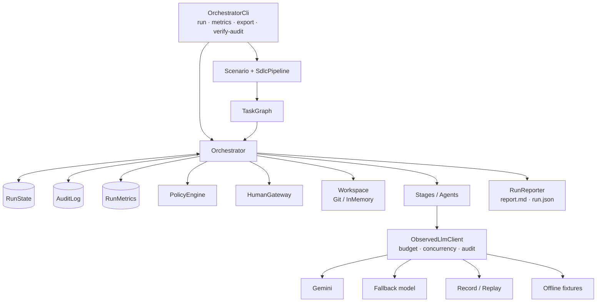
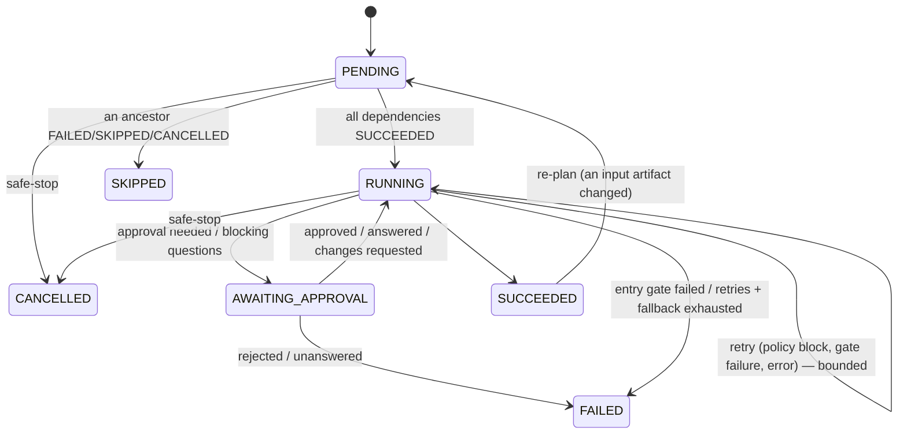

# Architecture

## 1. Goals and non-goals

**Goals:** turn a requirement into a reviewable engineering outcome through a non-linear, stateful,
governed workflow; make every agent action bounded, checkable, reversible and attributable; keep
humans in charge of high-impact decisions and final quality.

**Non-goals (this prototype):** multi-tenant job scheduling, durable resume after process crash,
fine-grained RBAC between approvers, sandboxed build execution.

## 2. Components



| Component | Responsibility | Notes |
|---|---|---|
| `TaskGraph` / `StageNode` | Immutable DAG; each node = stage + entry/exit gates + retry policy + optional fallback + approval flag + revision limit | Rejects cycles, unknown/self/duplicate deps at construction; computes parallel layers; renders Mermaid |
| `Orchestrator` | Scheduler and governance pipeline | Virtual threads; dependency edges are the synchronisation points |
| `RunState` | Shared cross-stage memory: statuses, artifacts (content-hashed), input hashes per node, decisions, clarifications, feedback, commits | Thread-safe; the basis for lineage and re-planning |
| `Stage` | The work. Agents (LLM-backed) or tools (repo index, release checklist) | Stages only *propose*: artifacts, file changes, questions, approval reasons |
| `Gate` | Deterministic check before (entry) or after (exit) a stage | Code, not prompts. Exceptions fail closed |
| `PolicyEngine` | Guardrails over every proposed change set | `BLOCK` / `REQUIRE_APPROVAL` / `WARN`; a throwing policy is a `BLOCK` |
| `HumanGateway` | Single channel for approvals and clarifications | Console (interactive), scripted (reproducible, labelled `(scripted)`), fail-closed |
| `Workspace` | Codebase under change | `GitWorkspace`: one commit per stage, rollback = reset to checkpoint; paths normalised, `..`/absolute/`.git` rejected |
| `AuditLog` | Append-only JSONL with SHA-256 hash chain | Tamper-evident; verifiable offline (`verify-audit`) |
| `RunMetrics` | Retries, rollbacks, fallbacks, MTTR, LLM calls/latency/tokens, human wait, approvals, policy blocks, re-plans | Latency reported with and without human wait |
| `LlmClient` chain | `Observed` (budget, concurrency, audit) → `Fallback` (primary → lighter model on retryable errors) → `Gemini` / `RecordReplay` / `Fixture` | Agents depend only on the interface |

## 3. Node lifecycle



## 4. The governance pipeline (per node)

```mermaid
sequenceDiagram
  participant O as Orchestrator
  participant S as Stage (agent)
  participant P as PolicyEngine
  participant H as Human
  participant W as Workspace
  O->>O: entry gates (fail → FAILED, stage never runs)
  loop attempts ≤ maxAttempts (then fallback stage, then FAILED)
    O->>S: execute(ctx: inputs, clarifications, feedback, previous failure)
    S-->>O: artifacts, file changes, decisions, questions, approval reasons
    alt blocking questions
      O->>H: clarify(questions)
      H-->>O: answers → RunState; re-execute (not counted as failure)
    end
    O->>P: evaluate(changes)
    alt BLOCK
      O-->>S: retry with violation as previous failure
    end
    opt node requires approval / policy REQUIRE_APPROVAL / agent-raised risk
      O->>H: approval request (reasons, paths, preview)
      H-->>O: APPROVED | REJECTED (→ FAILED) | CHANGES_REQUESTED (→ re-execute with feedback, bounded)
    end
    O->>W: [lock] checkpoint → apply → exit gates
    alt exit gate fails
      O->>W: reset to checkpoint (rollback); retry with gate output
    else
      O->>W: commit [unlock]
    end
  end
  O->>O: store artifacts with derivedFrom = input hashes; SUCCEEDED
```

## 5. Concurrency model

- Ready nodes (all parents `SUCCEEDED`) are submitted to a virtual-thread executor; the scheduler waits
  on a `CompletionService`. With the standard graph, `requirements ∥ repo-index` and
  `implementation ∥ tests ∥ docs` run concurrently; `impact-analysis` and `verify` are the joins.
- **Agent reasoning is parallel; workspace mutation is serialised.** `apply → exit gates → commit` is
  one critical section (a `ReentrantLock`, not `synchronized`, so blocked virtual threads don't pin
  carrier threads while a build runs). Rollback therefore resets only the current node's changes.
- Parallel branches own disjoint file sets (impl: production code, tests: `*/test/*`, docs: `*.md`),
  enforced in `TaskExecutionAgent`, so results never depend on scheduling order.
- The LLM client caps in-flight calls (provider rate limits).

## 6. State, lineage and re-planning

Every read of an upstream artifact goes through `StageContext.artifact(name)`, which records
`(node, artifact, hash)`. Outputs store `derivedFrom` = the hashes read. Consequences:

- **Lineage:** any artifact (e.g. `design.json`) traces back to the exact `requirements.json` version
  that shaped it — see the lineage table in each `report.md`.
- **Targeted re-plan:** `replan(artifact, newContent, reason, actor)` finds nodes whose recorded hash
  for that artifact is stale, invalidates them and their descendants, and `run()` re-executes only
  that sub-graph. In the ambiguous scenario, `repo-index` is not re-run because it never read
  `requirements.json`.
- **In-stage re-plan:** blocking questions → clarification → the same stage re-executes with answers.

## 7. Failure handling matrix

| Failure | Detection | Response | Bound |
|---|---|---|---|
| Transient model error (429/5xx/timeout/truncation) | `LlmException.retryable` | Model fallback (lighter model), then stage retry with backoff | `RetryPolicy.maxAttempts` |
| Permanent model error (auth, bad request, replay miss) | non-retryable | Skip remaining attempts → fallback stage → FAILED | 1 |
| Invalid JSON from model | parse error | Retry with error as context | `maxAttempts` |
| Hallucinated file reference | `impacted-files-exist` exit gate | Retry with the list of non-existent paths | `maxAttempts` |
| Policy violation | `PolicyEngine` BLOCK | Change rejected before touching disk; retry with violation | `maxAttempts` |
| Build/test failure | `build-and-test` exit gate | Rollback; repair agent gets the log; re-verify | `maxAttempts` (3) |
| Human rejection | approval | Node FAILED, descendants SKIPPED | — |
| Human requests changes | approval | Re-execute with feedback | `maxRevisions` |
| Ambiguity unanswered | clarification | FAILED (fail closed) | `maxClarificationRounds` (2) |
| Runaway agent | LLM call budget | Safe-stop: run STOPPED, pending CANCELLED | `maxLlmCalls` |
| Run too long | wall-clock budget | Safe-stop | `maxMinutes` |
| Operator stop | `KillSwitch.trip` | Safe-stop at next checkpoint | — |
| Gate or policy throws | exception | Treated as failure / BLOCK (fail closed) | — |

## 8. Policies

| Policy | Severity | Why |
|---|---|---|
| `security.secret-scan` | BLOCK | API keys (Google, OpenAI, Anthropic, AWS, GitHub), private keys, hard-coded passwords |
| `change-control.path-allowlist` | BLOCK | Agents write only inside the run's scope; traversal/absolute/`.git` rejected |
| `change-control.protected-files` | APPROVAL | CI workflows, Dockerfile, wrapper, CODEOWNERS govern how code is verified and shipped |
| `data.schema-migration` | APPROVAL / BLOCK | New migrations need sign-off (+ explicit flag for DROP/TRUNCATE); editing a released migration is blocked |
| `supply-chain.dependencies` | APPROVAL / BLOCK | Build file changes need sign-off; dynamic/SNAPSHOT versions blocked |
| `change-control.change-size` | APPROVAL / WARN | > 25 files or any deletion needs sign-off; very large files warned |
| `security.dangerous-code` | APPROVAL | Process exec, wildcard CORS, disabled CSRF, string-built SQL, disabled TLS checks, Java deserialisation |

## 9. Observability

- **Audit events:** `run.started/finished`, `node.status`, `node.attempt(.failed)`, `gate.evaluated`,
  `policy.evaluated`, `approval.decided`, `human.clarified`, `workspace.commit/rollback`,
  `artifact.produced`, `llm.call` (purpose, model, prompt/response hashes, latency, tokens), `llm.fallback`,
  `node.fallback`, `node.replan`, `run.replan`, `node.invalidated`, `node.skipped`.
- **Integrity:** each event includes `prevHash` and `hash = sha256(event)`. Editing, inserting or deleting
  any event breaks verification; the release stage re-verifies the chain as an entry *and* exit gate.
- **Metrics:** per node and per run in `run.json`; cross-run success rate, retry/rollback rate per node,
  MTTR and latency p50/p95 via `metrics`.
- **Privacy:** prompts and responses are referenced by hash in the audit log; raw recordings exist only
  when `--record` is used, under the scenario's `recordings/`.

## 10. Architecture decision records

**ADR-1 — Own engine instead of a workflow framework.** *Context:* the core differentiator is
governance, which must be explainable line by line. *Decision:* a small engine with zero runtime
dependencies. *Alternatives:* LangGraph (Python, different stack), Temporal (durable, heavy infra),
Spring State Machine (state, not DAG scheduling). *Consequences:* full control and testability; no
durable resume — mitigated by git commits and the audit log; a production version would persist
`RunState` (e.g. PostgreSQL) to resume after crashes.

**ADR-2 — Deterministic gates over LLM self-assessment.** *Decision:* "is it done?" is answered by
code (schema, file existence, build, audit chain). The model may *propose* fixes, never *approve* them.

**ADR-3 — Git as the change ledger and rollback mechanism.** *Decision:* one commit per stage on a run
branch. *Consequences:* rollback is a reset; every change is reviewable with normal tooling;
`changes.patch` is exported for reviewers.

**ADR-4 — Fail closed everywhere.** Missing approval = rejection; unanswered question = gate stays shut;
policy or gate exception = block; replay cache miss = error, never a silent live call.

**ADR-5 — Contract-first parallelism.** Tests are written from the design's API contract in parallel
with the implementation (not from the implementation), so they test intent rather than mirror the code;
`verify` is the join where disagreements surface.

**ADR-6 — Human gateway as a port.** Console, scripted and (future) web/Slack approvers implement one
interface; scripted decisions are labelled so the audit trail never implies a live human approved.

**ADR-7 (service) — 302 + async analytics + random codes.** See
[`url-shortener-service/README.md`](../url-shortener-service/README.md#design-notes).
