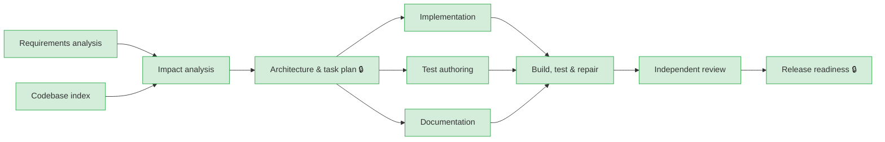

# Run report: `ambiguous-20261012-160231`

| | |
|---|---|
| Scenario | ambiguous |
| Outcome | **SUCCEEDED** — all stages succeeded |
| Model | fixtures(offline) |
| Audit chain | verified ✅ (153 events) |

## Requirement

> Make link analytics more useful for the marketing team, and make the service more reliable.

## Execution graph

## Stages

| Stage | Status | Attempts | Summary |
|---|---|---|---|
| requirements | SUCCEEDED | 2 | 2 functional requirements, 3 acceptance criteria, 3 ambiguities |
| repo-index | SUCCEEDED | 1 | 128 files, 5 endpoints, 3 entities, 2 migrations, 15 test files |
| impact-analysis | SUCCEEDED | 2 | 4 impacted files, 0 new files, schemaChange=false |
| design | SUCCEEDED | 3 | 4 tasks, 1 API operations, 1 ADRs |
| implementation | SUCCEEDED | 2 | 2 impl task(s) → 4 file(s) |
| tests | SUCCEEDED | 2 | 1 test task(s) → 1 file(s) |
| docs | SUCCEEDED | 2 | 1 docs task(s) → 1 file(s) |
| verify | SUCCEEDED | 2 | verifying merged change set |
| review | SUCCEEDED | 2 | APPROVE — 1 findings (0 blocking), 0 criteria not fully covered |
| release-readiness | SUCCEEDED | 2 | all release checks pass |

## Reliability metrics

| Metric | Value |
|---|---|
| e2eLatencyMs | 1986 |
| e2eLatencyExcludingHumanMs | 1985 |
| humanWaitMs | 1 |
| retries | 1 |
| rollbacks | 0 |
| fallbacks | 0 |
| recoveries | 0 |
| mttrMs | 0 |
| llmCalls | 17 |
| llmFailures | 0 |
| policyBlocks | 0 |
| approvalsGranted | 4 |
| approvalsRejected | 1 |
| replans | 2 |

## Human clarifications

- **Q:** What does 'more useful analytics' mean for marketing: which metrics, breakdowns or time windows?  [proposed default: Add a configurable time window to /stats.]
  **A:** Marketing wants to choose the time window for daily stats (between 7 and 90 days) and to see how many distinct sites referred traffic.
- **Q:** Which reliability problem should this increment address: availability, data durability, or abuse protection?  [proposed default: Add a Redis-backed rate limiter for multi-instance deployments.]
  **A:** Out of scope for this increment. We will first define SLOs and measure; open a separate ticket. Do not change reliability behaviour now.

## Decision log

| Stage | Kind | Actor | Decision | Rationale |
|---|---|---|---|---|
| requirements | CLARIFICATION | human:human | What does 'more useful analytics' mean for marketing: which metrics, breakdowns or time windows?  [proposed default: Add a configurable time window to /stats.] | Marketing wants to choose the time window for daily stats (between 7 and 90 days) and to see how many distinct sites referred traffic. |
| requirements | CLARIFICATION | human:human | Which reliability problem should this increment address: availability, data durability, or abuse protection?  [proposed default: Add a Redis-backed rate limiter… | Out of scope for this increment. We will first define SLOs and measure; open a separate ticket. Do not change reliability behaviour now. |
| requirements | REPLAN | system | Re-executing with 2 clarification(s) | ambiguity resolved by human |
| requirements | ASSUMPTION | agent:requirements | Must existing API clients be unaffected? | impact MEDIUM; default applied: Yes: additive and backward compatible. |
| requirements | ASSUMPTION | agent:requirements | Distinct referrers count hosts only (direct traffic excluded). | stated by requirements agent |
| design | CHANGES_REQUESTED | human:hemanth(scripted) | CHANGES_REQUESTED — stage 'Architecture & task plan' requires human sign-off | keep the default window at 30 days so existing clients see no change |
| design | HUMAN_APPROVAL | human:hemanth(scripted) | APPROVED — stage 'Architecture & task plan' requires human sign-off | backward compatible now |
| design | DESIGN_CHOICE | agent:design | Query-time aggregation | Aggregate click_event at request time using the (link_id, click_date) index \| alternatives: [Pre-aggregated daily table] \| consequences: No schema change; fine up to ~10^6 events per link within 90 days. |
| release-readiness | HUMAN_APPROVAL | human:hemanth(scripted) | APPROVED — stage 'Release readiness' requires human sign-off | scope matches the clarified requirement; reliability tracked separately |
| — | REPLAN | human:hemanth(scripted) | Upstream artifact 'requirements.json' changed; invalidated [impact-analysis, design, implementation, tests, docs, verify, review, release-readiness] | Stakeholder follow-up after the first run: marketing's dashboard needs the response to state which window was applied. |
| design | HUMAN_APPROVAL | human:hemanth(scripted) | APPROVED — stage 'Architecture & task plan' requires human sign-off | backward compatible now |
| design | DESIGN_CHOICE | agent:design | Query-time aggregation | Aggregate click_event at request time using the (link_id, click_date) index \| alternatives: [Pre-aggregated daily table] \| consequences: No schema change; fine up to ~10^6 events per link within 90 days. |
| release-readiness | HUMAN_APPROVAL | human:hemanth(scripted) | APPROVED — stage 'Release readiness' requires human sign-off | scope matches the clarified requirement; reliability tracked separately |

## Artifact lineage

| Artifact | Hash | Produced by | Derived from |
|---|---|---|---|
| requirements.json | `b3f491c1fb1f` | requirements | [] |
| repo-index.json | `ada4eb9a50e2` | repo-index | [] |
| impact-analysis.json | `dea30bed5f4a` | impact-analysis | [`b3f491c1fb1f`, `ada4eb9a50e2`] |
| design.json | `a2a89660eb60` | design | [`b3f491c1fb1f`, `dea30bed5f4a`] |
| tests-report.json | `c1c90f1f2107` | tests | [`a2a89660eb60`, `b3f491c1fb1f`] |
| docs-report.json | `74574290aef6` | docs | [`a2a89660eb60`, `b3f491c1fb1f`] |
| implementation-report.json | `23c0983f9cf7` | implementation | [`a2a89660eb60`, `b3f491c1fb1f`] |
| review.json | `ec641dd33e71` | review | [`a2a89660eb60`, `b3f491c1fb1f`] |
| release-readiness.md | `9afeffc00d81` | release-readiness | [`a2a89660eb60`, `b3f491c1fb1f`, `ec641dd33e71`] |
| release-notes.md | `03a99d868a41` | release-readiness | [`a2a89660eb60`, `b3f491c1fb1f`, `ec641dd33e71`] |
| requirements.json | `df5a730e91c6` | human:hemanth(scripted) | [] |
| impact-analysis.json | `dea30bed5f4a` | impact-analysis | [`df5a730e91c6`, `ada4eb9a50e2`] |
| design.json | `a2a89660eb60` | design | [`df5a730e91c6`, `dea30bed5f4a`] |
| tests-report.json | `897ac1537b14` | tests | [`a2a89660eb60`, `df5a730e91c6`] |
| docs-report.json | `74574290aef6` | docs | [`a2a89660eb60`, `df5a730e91c6`] |
| implementation-report.json | `23c0983f9cf7` | implementation | [`a2a89660eb60`, `df5a730e91c6`] |
| review.json | `f399b4db753e` | review | [`a2a89660eb60`, `df5a730e91c6`] |
| release-readiness.md | `464f1df33427` | release-readiness | [`a2a89660eb60`, `df5a730e91c6`, `f399b4db753e`] |
| release-notes.md | `03a99d868a41` | release-readiness | [`a2a89660eb60`, `df5a730e91c6`, `f399b4db753e`] |

## Files changed

- **release-readiness** (commit `8fd5c93aed88…`)
  - MODIFY `url-shortener-service/CHANGELOG.md`
- **tests** (commit `742330e750e1…`)
  - MODIFY `url-shortener-service/src/test/java/io/github/hemanthvk980/shortener/link/api/StatsWindowIntegrationTest.java`
- **implementation** (commit `52194ef090ed…`)
  - MODIFY `url-shortener-service/src/main/java/io/github/hemanthvk980/shortener/link/repo/ClickEventRepository.java`
  - MODIFY `url-shortener-service/src/main/java/io/github/hemanthvk980/shortener/link/service/LinkStats.java`
  - MODIFY `url-shortener-service/src/main/java/io/github/hemanthvk980/shortener/link/service/LinkService.java`
  - MODIFY `url-shortener-service/src/main/java/io/github/hemanthvk980/shortener/link/api/LinkController.java`
- **docs** (commit `227c913e005a…`)
  - MODIFY `url-shortener-service/README.md`
