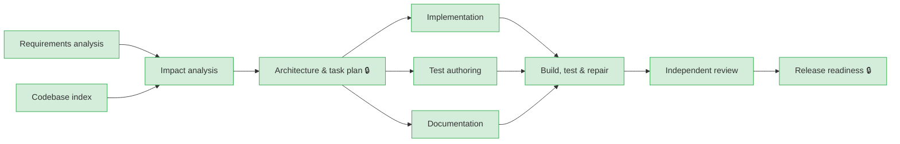

# Run report: `brownfield-20261012-160226`

| | |
|---|---|
| Scenario | brownfield |
| Outcome | **SUCCEEDED** — all stages succeeded |
| Model | fixtures(offline) |
| Audit chain | verified ✅ (81 events) |

## Requirement

> Marketing needs to shorten many URLs at once from a spreadsheet. Add a batch endpoint to the existing URL shortener that accepts up to 50 URLs in one request. Either all links are created or none: a single invalid URL must reject the whole batch and tell the caller which entries were wrong.

## Execution graph

## Stages

| Stage | Status | Attempts | Summary |
|---|---|---|---|
| requirements | SUCCEEDED | 1 | 3 functional requirements, 4 acceptance criteria, 2 ambiguities |
| repo-index | SUCCEEDED | 1 | 128 files, 5 endpoints, 3 entities, 2 migrations, 15 test files |
| impact-analysis | SUCCEEDED | 2 | 4 impacted files, 3 new files, schemaChange=false |
| design | SUCCEEDED | 1 | 4 tasks, 1 API operations, 2 ADRs |
| implementation | SUCCEEDED | 1 | 2 impl task(s) → 6 file(s) |
| tests | SUCCEEDED | 1 | 1 test task(s) → 1 file(s) |
| docs | SUCCEEDED | 1 | 1 docs task(s) → 1 file(s) |
| verify | SUCCEEDED | 1 | verifying merged change set |
| review | SUCCEEDED | 1 | APPROVE_WITH_COMMENTS — 2 findings (1 blocking), 0 criteria not fully covered |
| release-readiness | SUCCEEDED | 1 | all release checks pass |

## Reliability metrics

| Metric | Value |
|---|---|
| e2eLatencyMs | 3201 |
| e2eLatencyExcludingHumanMs | 3201 |
| humanWaitMs | 0 |
| retries | 1 |
| rollbacks | 1 |
| fallbacks | 0 |
| recoveries | 1 |
| mttrMs | 2018 |
| llmCalls | 9 |
| llmFailures | 0 |
| policyBlocks | 0 |
| approvalsGranted | 3 |
| approvalsRejected | 0 |
| replans | 0 |

## Decision log

| Stage | Kind | Actor | Decision | Rationale |
|---|---|---|---|---|
| requirements | ASSUMPTION | agent:requirements | Should batches support Idempotency-Key? | impact MEDIUM; default applied: Not in this increment; clients retry the whole batch. |
| requirements | ASSUMPTION | agent:requirements | Should a batch count as 1 or N requests for rate limiting? | impact MEDIUM; default applied: 1 request (existing filter); revisit before public exposure. |
| requirements | ASSUMPTION | agent:requirements | Batch size limit of 50 is fixed (not configurable) for now. | stated by requirements agent |
| impact-analysis | ROLLBACK | system | Rolled workspace back to 7d8e336fa0bdfa366c353c787876caf5816e0898 | exit gate 'impacted-files-exist' failed: model referenced files that do not exist: [url-shortener-service/src/main/java/io/github/hemanthvk980/shortener/link/service/LinkValidator.java] |
| impact-analysis | RETRY | system | Attempt failed | exit gate 'impacted-files-exist' failed: model referenced files that do not exist: [url-shortener-service/src/main/java/io/github/hemanthvk980/shortener/link/service/LinkValidator.java] |
| design | HUMAN_APPROVAL | human:hemanth(scripted) | APPROVED — stage 'Architecture & task plan' requires human sign-off | all-or-nothing is what marketing asked for; reuse of create() keeps behaviour identical |
| design | DESIGN_CHOICE | agent:design | All-or-nothing instead of partial success | Single transaction; any invalid entry rejects the batch \| alternatives: [207 Multi-Status with per-item results] \| consequences: Simple client semantics for spreadsheet imports; one bad row requires resubmitting the batc… |
| design | DESIGN_CHOICE | agent:design | Reuse create() per entry | Batch delegates to the existing single-create path \| alternatives: [Bulk INSERT] \| consequences: Identical validation/alias/expiry behaviour; 50 inserts per request is acceptable at this scale. |
| review | HUMAN_APPROVAL | human:hemanth(scripted) | APPROVED — review HIGH @ url-shortener-service/src/main/java/io/github/hemanthvk980/shortener/common/RateLimitFilter.java: A batch consumes one token but create… | risk accepted for the internal marketing rollout; follow-up ticket SHORT-142 weights rate-limit tokens by batch size before public exposure |
| release-readiness | HUMAN_APPROVAL | human:hemanth(scripted) | APPROVED — stage 'Release readiness' requires human sign-off | additive, backward-compatible API change; ship |

## Artifact lineage

| Artifact | Hash | Produced by | Derived from |
|---|---|---|---|
| requirements.json | `24ff4aef65b0` | requirements | [] |
| repo-index.json | `ada4eb9a50e2` | repo-index | [] |
| impact-analysis.json | `86d85deb0f8c` | impact-analysis | [`ada4eb9a50e2`, `24ff4aef65b0`] |
| design.json | `7a0d6d901117` | design | [`86d85deb0f8c`, `24ff4aef65b0`] |
| tests-report.json | `c12a25d8fe30` | tests | [`7a0d6d901117`, `24ff4aef65b0`] |
| docs-report.json | `70d759a9f465` | docs | [`7a0d6d901117`, `24ff4aef65b0`] |
| implementation-report.json | `291184783b39` | implementation | [`7a0d6d901117`, `24ff4aef65b0`] |
| review.json | `0f186edca8ac` | review | [`7a0d6d901117`, `24ff4aef65b0`] |
| release-notes.md | `b6543971ef77` | release-readiness | [`7a0d6d901117`, `0f186edca8ac`, `24ff4aef65b0`] |
| release-readiness.md | `8acaa3004f8f` | release-readiness | [`7a0d6d901117`, `0f186edca8ac`, `24ff4aef65b0`] |

## Files changed

- **release-readiness** (commit `027bdf40802c…`)
  - ADD `url-shortener-service/CHANGELOG.md`
- **docs** (commit `0e8ebf99b816…`)
  - MODIFY `url-shortener-service/README.md`
- **implementation** (commit `69d6606d4fa4…`)
  - MODIFY `url-shortener-service/src/main/java/io/github/hemanthvk980/shortener/link/service/LinkService.java`
  - ADD `url-shortener-service/src/main/java/io/github/hemanthvk980/shortener/link/service/BatchValidationException.java`
  - MODIFY `url-shortener-service/src/main/java/io/github/hemanthvk980/shortener/common/GlobalExceptionHandler.java`
  - ADD `url-shortener-service/src/main/java/io/github/hemanthvk980/shortener/link/api/BatchCreateRequest.java`
  - ADD `url-shortener-service/src/main/java/io/github/hemanthvk980/shortener/link/api/BatchCreateResponse.java`
  - MODIFY `url-shortener-service/src/main/java/io/github/hemanthvk980/shortener/link/api/LinkController.java`
- **tests** (commit `7289b705d9d2…`)
  - ADD `url-shortener-service/src/test/java/io/github/hemanthvk980/shortener/link/api/BatchCreateIntegrationTest.java`
