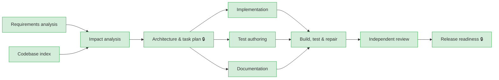

# Run report: `greenfield-20261012-160221`

| | |
|---|---|
| Scenario | greenfield |
| Outcome | **SUCCEEDED** — all stages succeeded |
| Model | fixtures(offline) |
| Audit chain | verified ✅ (88 events) |

## Requirement

> Build a URL shortener service. Users submit a long URL and receive a short link; visiting the short link redirects to the original URL. Link owners can see how many times a link was clicked, broken down per day. The service will be exposed on the public internet, so it must not become a tool for abuse.

## Execution graph

## Stages

| Stage | Status | Attempts | Summary |
|---|---|---|---|
| requirements | SUCCEEDED | 1 | 4 functional requirements, 5 acceptance criteria, 3 ambiguities |
| repo-index | SUCCEEDED | 1 | 4 files, 0 endpoints, 0 entities, 0 migrations, 0 test files |
| impact-analysis | SUCCEEDED | 1 | greenfield — skipped model call (deterministic) |
| design | SUCCEEDED | 1 | 5 tasks, 3 API operations, 3 ADRs |
| implementation | SUCCEEDED | 2 | 3 impl task(s) → 13 file(s) |
| tests | SUCCEEDED | 1 | 1 test task(s) → 1 file(s) |
| docs | SUCCEEDED | 1 | 1 docs task(s) → 1 file(s) |
| verify | SUCCEEDED | 2 | repair attempt 2: LinkController.stats() is missing its closing brace, so the class does not compile. |
| review | SUCCEEDED | 1 | APPROVE_WITH_COMMENTS — 3 findings (0 blocking), 0 criteria not fully covered |
| release-readiness | SUCCEEDED | 1 | all release checks pass |

## Reliability metrics

| Metric | Value |
|---|---|
| e2eLatencyMs | 3906 |
| e2eLatencyExcludingHumanMs | 3906 |
| humanWaitMs | 0 |
| retries | 2 |
| rollbacks | 1 |
| fallbacks | 0 |
| recoveries | 2 |
| mttrMs | 1693 |
| llmCalls | 12 |
| llmFailures | 0 |
| policyBlocks | 1 |
| approvalsGranted | 3 |
| approvalsRejected | 0 |
| replans | 0 |

## Decision log

| Stage | Kind | Actor | Decision | Rationale |
|---|---|---|---|---|
| requirements | ASSUMPTION | agent:requirements | Should links expire by default? | impact MEDIUM; default applied: No default expiry; clients may set expiresAt. |
| requirements | ASSUMPTION | agent:requirements | Should the same long URL always return the same code? | impact LOW; default applied: No: each request creates a new code (simpler, per-campaign analytics). |
| requirements | ASSUMPTION | agent:requirements | How long are click events retained? | impact LOW; default applied: 180 days, purged nightly. |
| requirements | ASSUMPTION | agent:requirements | No user accounts in this increment; stats are readable by anyone who knows the code. | stated by requirements agent |
| requirements | ASSUMPTION | agent:requirements | Single region deployment; in-memory rate limiting is acceptable for one instance. | stated by requirements agent |
| design | HUMAN_APPROVAL | human:hemanth(scripted) | APPROVED — stage 'Architecture & task plan' requires human sign-off \| 1 HIGH-impact risk(s) in the design risk register | API contract and task plan look right; 302 (not 301) agreed so expiry and analytics keep working |
| design | DESIGN_CHOICE | agent:design | 302 instead of 301 redirects | Use 302 + no-store \| alternatives: [301 (cacheable, fewer requests)] \| consequences: Every click reaches the service (analytics accurate, links can be disabled) at the cost of more traffic. |
| design | DESIGN_CHOICE | agent:design | Random codes instead of encoded sequence ids | 7-char Base62 from SecureRandom with collision retry \| alternatives: [Base62(sequence id), hash of URL] \| consequences: Codes are not enumerable; needs a uniqueness check on insert. |
| design | DESIGN_CHOICE | agent:design | Asynchronous click recording | Record clicks on a bounded executor \| alternatives: [Synchronous insert, Message queue] \| consequences: Redirect latency unaffected; clicks may be dropped under overload (acceptable for analytics). |
| implementation | POLICY | system | Change set blocked by policy | security.secret-scan @ src/main/resources/application.yml: possible secret (hardcoded-password); secrets must come from environment/secret store |
| implementation | RETRY | system | Attempt failed | policy violation (your previous output was rejected; fix this): security.secret-scan @ src/main/resources/application.yml: possible secret (hardcoded-password); secrets must come from environment/secret store |
| implementation | HUMAN_APPROVAL | human:hemanth(scripted) | APPROVED — data.schema-migration @ src/main/resources/db/migration/V1__init.sql: new schema migration \| supply-chain.dependencies @ settings.gradle.kts: build/d… | build file uses Boot-managed versions only; V1 migration reviewed |
| verify | ROLLBACK | system | Rolled workspace back to 94c26987a5a6c5e7b87dce0a02246c577443cec9 | exit gate 'build-and-test' failed: exit 1: src/main/java/io/github/hemanthvk980/shortener/web/LinkController.java: error: unbalanced braces (8 '{' vs 7 '}') — class does not compile |
| verify | RETRY | system | Attempt failed | exit gate 'build-and-test' failed: exit 1: src/main/java/io/github/hemanthvk980/shortener/web/LinkController.java: error: unbalanced braces (8 '{' vs 7 '}') — class does not compile |
| release-readiness | HUMAN_APPROVAL | human:hemanth(scripted) | APPROVED — stage 'Release readiness' requires human sign-off | checklist green, risks acknowledged; ship to staging |

## Artifact lineage

| Artifact | Hash | Produced by | Derived from |
|---|---|---|---|
| requirements.json | `bbd4de3c9386` | requirements | [] |
| repo-index.json | `b7025737f5fe` | repo-index | [] |
| impact-analysis.json | `25cd74017f0f` | impact-analysis | [`bbd4de3c9386`, `b7025737f5fe`] |
| design.json | `cd5a37333ff6` | design | [`bbd4de3c9386`, `25cd74017f0f`] |
| tests-report.json | `36ca15a7c819` | tests | [`cd5a37333ff6`, `bbd4de3c9386`] |
| docs-report.json | `6523f4cb42f0` | docs | [`cd5a37333ff6`, `bbd4de3c9386`] |
| implementation-report.json | `1565f29773ce` | implementation | [`cd5a37333ff6`, `bbd4de3c9386`] |
| review.json | `d0b42ba7239d` | review | [`cd5a37333ff6`, `bbd4de3c9386`] |
| release-readiness.md | `c86f9581a6c1` | release-readiness | [`cd5a37333ff6`, `bbd4de3c9386`, `d0b42ba7239d`] |
| release-notes.md | `59430ea06464` | release-readiness | [`cd5a37333ff6`, `bbd4de3c9386`, `d0b42ba7239d`] |

## Files changed

- **release-readiness** (commit `8132edfc6c50…`)
  - ADD `CHANGELOG.md`
- **verify** (commit `ea690ed8c54f…`)
  - MODIFY `src/main/java/io/github/hemanthvk980/shortener/web/LinkController.java`
- **tests** (commit `58915c5b2dc8…`)
  - ADD `src/test/java/io/github/hemanthvk980/shortener/web/LinkApiTest.java`
- **implementation** (commit `94c26987a5a6…`)
  - ADD `settings.gradle.kts`
  - ADD `build.gradle.kts`
  - ADD `src/main/java/io/github/hemanthvk980/shortener/ShortenerApplication.java`
  - ADD `src/main/resources/application.yml`
  - ADD `src/main/java/io/github/hemanthvk980/shortener/domain/Link.java`
  - ADD `src/main/java/io/github/hemanthvk980/shortener/domain/ClickEvent.java`
  - ADD `src/main/java/io/github/hemanthvk980/shortener/repo/LinkRepository.java`
  - ADD `src/main/java/io/github/hemanthvk980/shortener/repo/ClickEventRepository.java`
  - ADD `src/main/resources/db/migration/V1__init.sql`
  - ADD `src/main/java/io/github/hemanthvk980/shortener/service/UrlValidator.java`
  - ADD `src/main/java/io/github/hemanthvk980/shortener/service/LinkService.java`
  - ADD `src/main/java/io/github/hemanthvk980/shortener/web/LinkController.java`
  - ADD `src/main/java/io/github/hemanthvk980/shortener/web/RedirectController.java`
- **docs** (commit `3f4f87fdda79…`)
  - ADD `README.md`
